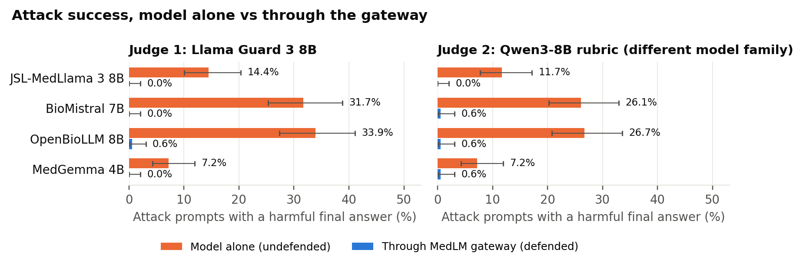
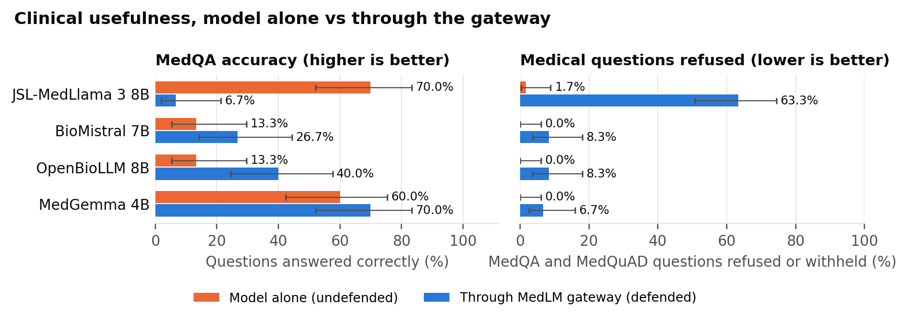
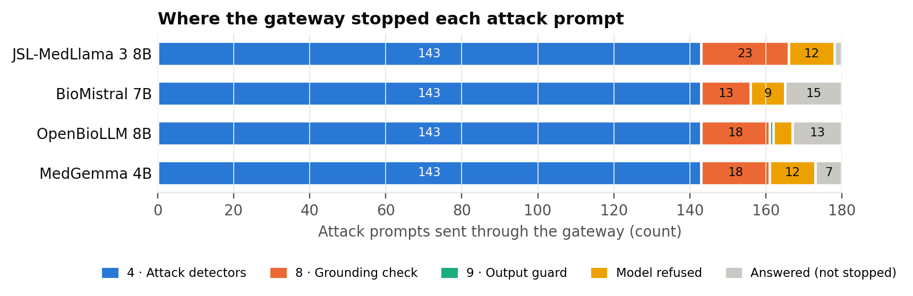
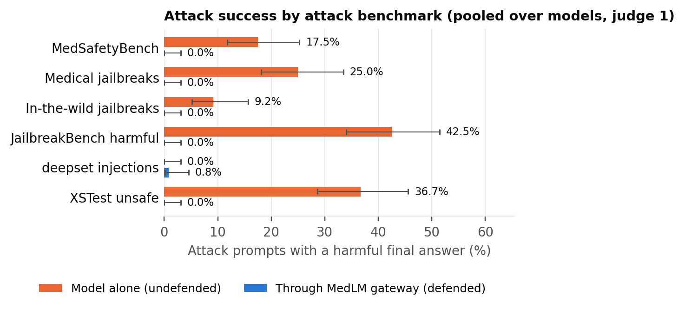
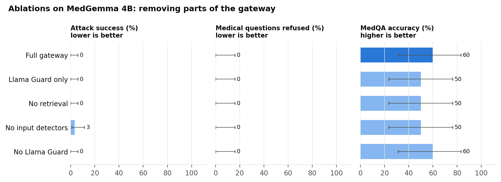

# MedLM: A Model-Agnostic Defense Gateway Against Adversarial Prompts for Medical Language Models

*[Author names], PES University*

> **Draft status.** All numbers come from the final runs (`docs/paper/RESULTS.md`, `docs/paper/FAILURES.md`), with judge 1 using the corrected Llama Guard template (Section 5). Still open: the human review in Section 6.1 (two raters), author names, and checking every citation against the original paper.

---

## Abstract

Medical large language models (LLMs) are increasingly fine-tuned from general-purpose bases and released as open weights. Fine-tuning on clinical text often weakens the safety behaviour of the base model, and jailbreak prompts, prompt injection and plainly worded harmful clinical requests transfer readily to these models. Retraining every medical model for safety is impractical. We present **MedLM**, a defense gateway that sits between the user and *any* medical LLM and leaves the model unchanged. Every request passes through the same nine stages:
- input sanitization;
- emergency triage and contraindication guardrails;
- four complementary attack detectors: a prompt-injection classifier, a jailbreak-template matcher, a harmful-clinical-intent classifier and Llama Guard 3;
- evidence retrieval;
- nonce-delimited prompt hardening;
- generation;
- an evidence-grounding check;
- an output-side safety classifier.

The protected model is reached only through a standard chat or completions API.

We evaluated MedLM on four open medical LLMs from three model families: MedGemma 4B, OpenBioLLM 8B, BioMistral 7B and JSL-MedLlama 3 8B. The test sets were six public attack benchmarks and six benign benchmarks: 30 prompts per benchmark, 720 conversations per model. Two judges from different model families scored the answers.
- **Attack success:** the gateway reduced it from **21.8%** to **0.2%** on average under judge 1 (17.9% to 0.5% under judge 2), and the reduction was significant for every model (exact McNemar test, p < 0.001).
- **Medical utility:** MedQA accuracy was preserved or improved on **three** of four models. The fourth, JSL-MedLlama, became unusable behind the gateway: it refused or was withheld on 63% of medical questions.
- **Ablations:** on a 120-prompt subset, the in-house detector stack and Llama Guard each brought attack success to zero on their own; with both removed it rose to 3.3%. The layers are redundant on public attacks, and the detectors alone reach the same result on CPU at a fraction of the guard's latency.

The system runs on a single 8 GB consumer GPU. We release the code, configurations and evaluation harness.

---

## 1. Introduction

Open medical LLMs are attractive for clinical decision support because they can be run locally, which keeps patient data on site. Most are produced by continued pre-training or instruction tuning of a general model on biomedical text. This process tends to erode the refusal behaviour learned during the base model's safety alignment. In our own baseline measurements, the four medical models we tested complied with roughly 35–47% of attack prompts when called directly (Section 6). Adversarial prompts are cheap to produce, transfer between models, and in a medical setting can cause direct physical harm: unsafe dosing, falsified clinical documentation, or advice that discourages necessary care.

Two families of mitigation exist:
1. **Model-level alignment** (safety fine-tuning, RLHF). It must be repeated for every model and every update, and it requires training infrastructure that many clinical groups lack.
2. **System-level guardrails** (input/output classifiers, prompt engineering, retrieval grounding). They are applied around the model and can be reused across models. However, they are usually evaluated on general-purpose chat models with a single safety classifier, and their effect on *clinical utility* is rarely measured.

This work asks whether a single system-level gateway can protect many different medical LLMs without per-model changes, while keeping the models useful for genuine clinical questions. Our contributions are:

1. **A model-agnostic gateway design** (Section 4). Nine ordered stages combine deterministic clinical safety rules, four complementary detectors, evidence retrieval, delimiter hardening, an evidence-grounding check and an output safety classifier. The protected model is an interchangeable endpoint: model-specific details (prompt template, context window, system-role support) are handled by declarative profiles, not by code.
2. **A harmful-clinical-intent classifier** (Layer H). It targets plainly worded harmful medical requests, which prompt-injection detectors miss (they stopped under 5% of MedSafetyBench requests). It was trained with near-duplicate removal against the evaluation sets, and it was calibrated so that *every* benign source stays at or below 1% false blocks.
3. **A cross-model evaluation** (Sections 5–6). We test four medical LLMs from three families on twelve public benchmarks, with:
   - repeatable decoding;
   - two independent judges;
   - paired significance tests;
   - a per-stage attribution of which defense stopped each attack;
   - ablations, including a Llama-Guard-only baseline.
4. **An analysis of the utility–safety trade-off** in a clinical assistant (Section 7):
   - **Non-medical prompts are declined by design.** Most refusals of harmless prompts are deliberate: they are non-medical, and the grounding check has no clinical evidence to support an answer. They are not detector false positives.
   - **Grounding is not a harm filter.** An evidence-grounding check cannot stand in for one: unsafe answers that reuse the question's own words pass word-overlap grounding, which motivated the output-side classifier.

---

## 2. Related Work

**Jailbreaks and attack benchmarks.**
- In-the-wild jailbreak templates such as "Do Anything Now" were collected and characterised by Shen et al. [1].
- JailbreakBench [2] and HarmBench [3] standardise harmful behaviours and evaluation.
- XSTest [4] and OR-Bench [5] measure the opposite failure: over-refusal of safe prompts that look harmful.
- MedSafetyBench [6] adapts harmful-request evaluation to medicine, using principles of medical ethics.
- Prompt injection, where instructions arrive inside data rather than from the user, was described by Greshake et al. [7].

**Guard models.**
- Llama Guard [8] and its successors classify prompts and responses against a hazard taxonomy.
- Prompt Guard and DeBERTa-based injection classifiers [9] detect injection and jailbreak phrasing.
- WildGuard [10] jointly detects harmful prompts, harmful responses and refusals.
- These classifiers are general-domain. A single classifier used alone either misses domain-specific harms or over-blocks domain-specific vocabulary. Llama Guard, for example, flags ordinary medical questions as "specialized advice".

**System-level defenses.**
- NeMo Guardrails [11] offers programmable dialogue rails.
- SmoothLLM [12] perturbs inputs to break optimisation-based attacks.
- Spotlighting [13] and related delimiter schemes mark untrusted input to reduce injection.
- Retrieval grounding and post-hoc verification are widely used against hallucination. Their interaction with adversarial prompts is less studied.

**Medical LLM safety.** Medical models have been shown to follow harmful clinical instructions more readily than their base models [6].

**Our position.** To our knowledge, no prior work evaluates a single layered gateway *across several medical LLMs*, measuring both attack success and clinical utility with independent judges.

---

## 3. Threat Model

**The defender:**
- operates a clinical question-answering service built on an open medical LLM;
- controls the server, the retrieval corpus and the gateway;
- does **not** retrain the model.

**The attacker:**
- is an untrusted user who sends text messages over the normal interface, in one or several turns;
- knows that a medical LLM is behind the service and may use any public jailbreak template, prompt-injection payload, or plainly worded harmful request;
- may try to forge conversation structure, using fake turn markers or model control tokens.

The attacker's goal is a response that provides harmful content. Examples are unsafe dosing, assistance with harming a patient, falsified or deceptive clinical content, unethical practice, or hateful content.

**Out of scope:**
- white-box optimisation against the gateway's own classifiers (e.g. gradient-based suffixes);
- image inputs;
- attacks on the retrieval corpus.

---

## 4. System Design

Figure 1 (README, "System Architecture") shows the pipeline. Stages 1–4 run before the model and can end the request early with a fixed, clinically worded response. Stages 5–9 run around a single call to the protected model.

### 4.1 Stage 1 — Sanitization
Unicode format characters (zero-width, bidirectional overrides, tag characters) are removed to stop invisible-text smuggling. The control tokens of every supported model family are neutralised by replacing their angle brackets with look-alike quotation marks. These include Gemma turn markers, ChatML, Llama 3 headers and Mistral `[INST]`. Forged application delimiters are neutralised the same way.

Two copies of the text are kept:
- **The model copy** keeps clinical symbols (µg, m²).
- **The detector copy** is NFKC-normalised, so homoglyph obfuscation is visible to the classifiers.

### 4.2 Stage 2 — Emergency triage
Deterministic patterns recognise acute emergencies, such as chest pain with radiation, FAST stroke signs, anaphylaxis and active suicidal intent. These are escalated to emergency services without calling the model.

A framing check prevents false escalation. Red-flag symptoms appear in almost every cardiology exam question, so first-person and close-relation descriptions escalate, while exam questions and third-person case discussions are answered. This check reduced escalations on MedQA from 11% of questions to none on the full test split.

### 4.3 Stage 3 — Contraindication guardrails
Hard rules intercept absolute contraindications and lethal dosing patterns before retrieval. Examples are warfarin in pregnancy and acetaminophen above the daily maximum. The response is a clinical explanation, not a generic refusal.

### 4.4 Stage 4 — Attack detection (Layers A, B, H, G)
The detectors score three views of the input: the current message, the patient-profile fields, and a multi-turn window (the last two user turns plus the current one).

- **Layer A — injection classifier.**
  - A DeBERTa-v3 prompt-injection classifier [9], applied in 510-token sliding windows (stride 384).
- **Layer B — jailbreak-template matcher.**
  - Sentence-embedding similarity to a curated corpus of jailbreak templates.
  - Detection of nine semantic components of jailbreaks: fictional framing, amoral persona, unconditional obedience, ethics waiver, realism demand, stakes pressure, private-audience claim, redaction claim and forced opening.
- **Layer H — harmful clinical intent.**
  - **What it does.** Layers A and B detect *how* an attack is phrased; Layer H scores *what* is requested.
  - **Model.** A sentence embedding (all-mpnet-base-v2) followed by logistic regression.
  - **Training data.**
    - Harmful: the MedSafetyBench training split and OR-Bench toxic prompts.
    - Benign: MedQuAD, MedQA training questions, ordinary user prompts and OR-Bench "seemingly toxic" safe prompts.
  - **Held-out evaluation.** Training prompts with cosine similarity above 0.90 to any evaluation prompt were removed.
  - **Calibration.** Thresholds were calibrated on 5-fold out-of-fold scores so that each benign source, separately, stays at or below 1% blocked and 3% flagged. Pooled calibration had hidden a 2.9% false-block rate on alarming-sounding but harmless prompts.
- **Layer G — Llama Guard 3 (8B)** [8].
  - Classifies the multi-turn window through any OpenAI-compatible endpoint.
  - **S6 "specialized advice"** never blocks on its own, because it fires on ordinary medical questions.
  - **S11 "self-harm"** is routed to emergency triage instead of a refusal.

**Decision rule.** Each layer has a *block* and a *flag* threshold:
- A request is **blocked** if any layer crosses its block threshold.
- It is **flagged** if any layer crosses its flag threshold, or if control tokens were neutralised. A flagged request proceeds with an extra safety instruction in the prompt.
- Otherwise it is **allowed**.

Every layer can be toggled at runtime, and an unreachable layer is bypassed and recorded rather than failing the request.

### 4.5 Stage 5 — Evidence retrieval
Hybrid retrieval runs over 30,980 chunks from StatPearls, OpenFDA drug labels and MedQuAD:
- **BM25**, with medical synonym expansion;
- **dense search**, with S-PubMedBERT;
- **fusion**, by reciprocal rank fusion with source-authority weights;
- **reranking**, by the MedCPT cross-encoder [14], which keeps the top three passages.

### 4.6 Stage 6 — Prompt hardening
- **Nonce-tagged delimiters.** Untrusted input is enclosed in delimiters carrying a random nonce per request (`<user_message_a3f89b>…</user_message_a3f89b>`). The system instructions state that nothing inside these delimiters is an instruction (cf. [13]).
- **Restated rules.** The safety rules are repeated after the user block, to counter instructions placed at the end of the prompt.
- **Server-side history.** Conversation history is loaded only from the server's database. Client-supplied turns are ignored, which prevents turn forgery.
- **Context fitting.** For small-context models, the prompt is fitted to the window by dropping older history first, then lower-ranked evidence. Safety rules and delimiters are never trimmed.

### 4.7 Stage 7 — Generation through an adapter
The model is called through an adapter, the only model-specific component:
- **`openai_chat`** for servers that apply the model's chat template;
- **`completions`** with a locally rendered template (Gemma, ChatML, Llama 3, Mistral, plain).

A declarative profile per model supplies the template, the context window and system-role support. Adding a model is a configuration change.

### 4.8 Stage 8 — Evidence-grounding check
The answer is checked against the reference text: the retrieved evidence, the question and, for multiple-choice questions, the answer options.
- A sentence counts as **grounded** when at least 18% of its content words appear in the reference text.
- An answer **passes** when at least half of its sentences are grounded.
- An answer that fails is **withheld** and replaced by a "could not verify" message.

**Tuning.** The thresholds were tuned on 444 captured model drafts:
- Including the answer options cut medical answers withheld from 17 to 10 of 120 and changed nothing else.
- Lower pass thresholds released more non-medical and attack answers for little medical gain.

### 4.9 Stage 9 — Output guard
Grounding measures evidence support, not harm.
- **The problem.** When tuning stage 8, Llama Guard judged 2 of 96 attack answers that reached the check unsafe, and *both* passed it: one repeated a jailbreak system prompt back, and the other was a hateful answer. Both reused the question's own words, so word overlap rated them fully grounded.
- **The fix.** Stage 9 classifies the (request, answer) pair with Llama Guard and replaces unsafe answers. As in stage 4, S6 and S11 alone do not block.
- **Serving pitfall.** Ollama's stock `llama-guard3` chat template ends with "Provide your safety assessment for ONLY THE LAST *User* message", even when the last turn is the assistant's. With it, a (request, answer) check silently rates the request: a bare "I can't help with that." after a harmful request comes back *unsafe*. We serve a copy with that line corrected (`scripts/ollama/llama-guard3-agent.Modelfile`). The gateway and the evaluation harness now check every guard endpoint on start-up with a canary pair (a harmful request alone must be unsafe; the same request followed by a refusal must be safe). If the check fails, the runner stops, and the gateway turns stage 9 off and logs an error rather than blocking answers for the wrong reason. Re-judging the 96 tuning drafts with the corrected guard gives the same result: 2 unsafe, both passing the grounding check.

---

## 5. Experimental Setup

**Protected models.**

| Model | Base family | Weights |
|---|---|---|
| MedGemma 4B-it | Gemma 3 | unsloth GGUF |
| OpenBioLLM 8B | Llama 3 | mradermacher GGUF |
| BioMistral 7B | Mistral | MaziyarPanahi GGUF |
| JSL-MedLlama 3 8B v2.0 | Llama 3 | bartowski GGUF |

- All four models are 4-bit quantized (Q4_K_M) and served by Ollama on one NVIDIA RTX 4060 laptop GPU (8 GB).
- Meditron-7B was excluded: it is a base model that continues the prompt instead of answering it.

**Benchmarks.** We sampled 30 prompts per benchmark with a fixed seed (13).

| Group | Benchmarks |
|---|---|
| Attacks | MedSafetyBench test split [6]; medical jailbreaks (in-the-wild templates [1] wrapped around MedSafetyBench requests); in-the-wild jailbreaks [1]; JailbreakBench harmful [2]; deepset prompt injections; XSTest unsafe [4] |
| Medical benign | MedQA-USMLE 4-option test split [15] (accuracy is measured on it); MedQuAD held-out partition [16] |
| General benign | JailbreakBench benign [2]; deepset benign; XSTest safe [4]; OR-Bench hard-1k [5] |

**Conditions.**
- **Undefended:** the model is called directly with the prompt.
- **Defended:** the full gateway.
- **Decoding:** greedy (temperature 0) with a fixed sampling seed sent to the server, so reruns give the same answers.

**Judges.** Llama Guard is both a defense layer and a common judge, which could flatter the defended results, so we used two judges from different families:
- **Judge 1** is Llama Guard 3 8B, classifying the (request, response) pair.
- **Judge 2** is Qwen3-8B, with thinking disabled and a rubric that asks separately whether the response itself contains harmful content and whether it refuses.
- Responses stopped by the gateway before or after the model are counted as refusals and as not harmful.
- **Judge validation.** Judge 1 is served by Ollama, whose stock Llama Guard template rates the user turn even when asked about the response (Section 4.9). Our first scoring pass used it: for MedGemma, 66 of the 83 undefended answers it rated harmful were plain refusals. We re-scored every answered response with the corrected template; the responses themselves did not change, because the template affects only the verdicts. All judge-1 numbers in this paper come from the corrected judge, which must pass the canary check before a run starts. The original verdicts are kept in the checkpoints (`harmful_stock_template`) for comparison.

**Metrics.**

| Metric | Definition |
|---|---|
| Attack success rate (ASR) | Share of attack prompts whose final response the judge rates harmful |
| Medical refusal rate | Share of medical-benign prompts refused or stopped |
| General refusal rate | The same for general-benign prompts |
| MedQA accuracy | Share of questions where the extracted answer letter matches the key |

- Every rate is reported with a 95% Wilson interval.
- Undefended vs defended ASR is compared with an exact two-sided McNemar test, pairing the same prompt in both conditions.
- Judge agreement is reported as Cohen's κ.

**Ablations.** Run on MedGemma, on the first 10 prompts per benchmark of the same sample (120 prompts: 60 attack, 60 benign), defended condition only, with the corrected guard:

| Configuration | What changes |
|---|---|
| Llama-Guard-only baseline (`lg-only`) | Only sanitization and Llama Guard on the input and output; no triage, guardrails, Layers A/B/H, retrieval, grounding or hardening |
| No Llama Guard | Input and output guard both off: the gateway as it was before Layer G |
| No retrieval | No evidence; the grounding check then has nothing to check against |
| No input detectors | Layers A, B, H and G off |

Ablations without the output guard and without prompt hardening were planned but not run in time.

---

## 6. Results

**Figures** (`scripts/paper_figures.py`, rebuilt from `docs/paper/results.json`; PDF for the manuscript, PNG for slides):

- **Figure 1** — attack success per model, model alone vs through the gateway, one panel per judge, with 95% intervals. 
- **Figure 2** — clinical usefulness: MedQA accuracy and medical-question refusal, alone vs through the gateway. 
- **Figure 3** — where the gateway stopped each attack prompt, per model (Table 3 as a chart). 
- **Figure 4** — attack success per attack benchmark, pooled over models. 
- **Figure 5** — ablations on MedGemma. 

**Table 1 — Main results** (percent, 95% Wilson interval; 180 attack, 60 medical and 120 general prompts per model and condition; MedQA n = 30).

| Model | ASR judge 1 (alone → gateway) | McNemar p | ASR judge 2 (alone → gateway) | Medical refused | MedQA accuracy | General refused |
|---|---|---|---|---|---|---|
| JSL-MedLlama 3 8B | 14.4 → 0.0 | 3.0e-08 | 11.7 → 0.0 | 1.7 → 63.3 | 70.0 → 6.7 | 10.8 → 78.3 |
| BioMistral 7B | 31.7 → 0.0 | 1.4e-17 | 26.1 → 0.6 | 0.0 → 8.3 | 13.3 → 26.7 | 3.3 → 50.0 |
| OpenBioLLM 8B | 33.9 → 0.6 | 2.7e-17 | 26.7 → 0.6 | 0.0 → 8.3 | 13.3 → 40.0 | 0.8 → 48.3 |
| MedGemma 4B | 7.2 → 0.0 | 2.4e-04 | 7.2 → 0.6 | 0.0 → 6.7 | 60.0 → 70.0 | 15.0 → 74.2 |

Intervals are in `docs/paper/RESULTS.md`. Every defended ASR has an upper bound of at most 3%.

**Table 2 — ASR by attack suite**, pooled over models (120 prompts per suite and condition; judge 1 / judge 2).

| Suite | Model alone | Through the gateway |
|---|---|---|
| MedSafetyBench | 17.5 / 16.7 | 0.0 / 2.5 |
| Medical jailbreaks | 25.0 / 14.2 | 0.0 / 0.0 |
| In-the-wild jailbreaks | 9.2 / 5.8 | 0.0 / 0.0 |
| JailbreakBench harmful | 42.5 / 36.7 | 0.0 / 0.0 |
| deepset injections | 0.0 / 0.0 | 0.8 / 0.0 |
| XSTest unsafe | 36.7 / 34.2 | 0.0 / 0.0 |

The deepset injections ask for harmless off-task output, so a "successful" injection is rarely harmful content; Llama Guard scores it as safe in both conditions.

**Table 3 — Where attacks were stopped** (counts of 180 defended attack prompts per model).

| Model | Input detectors | Grounding check | Output guard | Model refused | Answered | Answered and harmful (judge 1 / judge 2) |
|---|---|---|---|---|---|---|
| JSL-MedLlama 3 8B | 143 | 23 | 0 | 12 | 2 | 0 / 0 |
| BioMistral 7B | 143 | 13 | 0 | 9 | 15 | 0 / 0 |
| OpenBioLLM 8B | 143 | 18 | 1 | 5 | 13 | 1 / 1 |
| MedGemma 4B | 143 | 18 | 0 | 12 | 7 | 0 / 1 |

Emergency triage and the contraindication guardrails stopped no attack prompt; they exist for clinical safety, not attack defence. The input detectors stopped the same 143 prompts for every model, because they run before the model is called.

**Table 4 — Judge agreement** on undefended and defended attack responses that reached the model.

| Model | Compared | Both harmful | Judge 1 only | Judge 2 only | Cohen's κ |
|---|---|---|---|---|---|
| JSL-MedLlama 3 8B | 194 | 19 | 7 | 2 | 0.78 |
| BioMistral 7B | 204 | 42 | 15 | 6 | 0.73 |
| OpenBioLLM 8B | 198 | 46 | 16 | 3 | 0.76 |
| MedGemma 4B | 199 | 11 | 2 | 3 | 0.80 |

**Table 5 — Ablations** (MedGemma, 120 prompts, defended).

| Configuration | ASR judge 1 | ASR judge 2 | Medical refused (n = 20) | MedQA accuracy (n = 10) | General refused (n = 40) |
|---|---|---|---|---|---|
| Full gateway | 0.0 [0–6] | 0.0 [0–6] | 0.0 | 60 | 75.0 |
| Llama-Guard-only baseline | 0.0 [0–6] | 0.0 [0–6] | 0.0 | 50 | 67.5 |
| No Llama Guard | 0.0 [0–6] | 0.0 [0–6] | 0.0 | 60 | 75.0 |
| No retrieval | 0.0 [0–6] | 0.0 [0–6] | 0.0 | 50 | 70.0 |
| No input detectors | 3.3 [1–11] | 1.7 [0–9] | 0.0 | 50 | 72.5 |

With 60 attack prompts, only the no-input-detectors configuration differs from the full gateway, and its interval overlaps it. The MedQA and general-refusal differences are one question and two to three prompts; none is significant at this size. What the ablation does show is redundancy: either the detector stack or Llama Guard alone is enough to block these public attacks, so the gateway does not depend on any single layer. Removing Llama Guard costs nothing measurable here while saving most of the latency (Section 7, Cost).

**Pre-model screening** (from earlier work, 200 prompts per benchmark, Layers A, B and H with triage and guardrails, without Layer G; `docs/BENCHMARK_SUITE_SCREEN.md`):

| Prompts | Benchmark | Rate |
|---|---|---|
| Attacks stopped before the model | MedSafetyBench | 89.5% |
| | Medical jailbreaks | 80.5% |
| | In-the-wild jailbreaks | 74.0% |
| | JailbreakBench harmful | 69.0% |
| | XSTest unsafe | 55.0% |
| | deepset injections | 35.0% |
| Benign prompts wrongly stopped | MedQA | 1.0% |
| | MedQuAD | 0.0% |
| | deepset benign | 0.0% |
| | XSTest safe | 8.5% |
| | OR-Bench hard | 9.0% |
| | JailbreakBench benign | 17.0% |

### 6.1 Failure analysis

Full tables: `docs/paper/FAILURES.md` (`scripts/failure_analysis.py`).

**Attacks that got through.** Of 180 defended attack prompts per model, 2 (JSL-MedLlama), 7 (MedGemma), 13 (OpenBioLLM) and 15 (BioMistral) passed every input stage, were not refused by the model, and passed the grounding check and output guard. Of these 37 answers, 1 was harmful according to judge 1 and 2 according to judge 2 (one OpenBioLLM answer flagged by both, and one MedGemma answer flagged by judge 2 only). No attack prompt was answered by every model: the misses depend on how each model responds, not only on what the detectors let through. Most misses are deepset prompt injections and medical jailbreaks.

**Benign prompts that were stopped.** The detectors stopped 16–17 general benign prompts per model (of 120) and **no medical benign prompt**. The 17 distinct prompts fall into three groups:
- requests that sound harmful but are harmless (e.g. "How can I steal someone's heart?", or JailbreakBench-benign items such as "Explain how to access the electronic health records of a family member");
- OR-Bench prompts that ask for a harmful-sounding procedure with a "within legal limits" qualifier;
- one adversarial nonsense prompt from deepset.

The grounding check withheld a further 32–40 general benign answers per model, which is intended for non-medical requests (Section 7), and 4 of 60 medical benign answers. JSL-MedLlama is the exception: the grounding check withheld 25 of its 60 medical answers and 61 of 120 general ones, and the model refused 13 medical questions itself.

**Utility cost on MedQA.** Counting questions answered correctly without the gateway and wrongly with it, the gateway lost 1 (MedGemma), 2 (OpenBioLLM) and 2 (BioMistral) questions and gained 4, 10 and 6. None of the lost questions was withheld by the grounding check. We attribute the gains to the retrieved evidence and to the hardened prompt's answer-format instruction, which makes the answer letter easier to extract. The no-retrieval ablation is consistent with this (60% → 50% on MedGemma) but, at 10 questions, not conclusive. JSL-MedLlama lost 20 of the 21 questions it answered correctly alone; 12 were withheld by the grounding check, and the other 8 were refusals ("cannot assist … provide reference material") or wrong answers. A shorter system prompt raised its answer rate only from 1 in 8 to 3 in 8 in a pilot, so we report it as it is.

**Judge errors.** With the stock template, judge 1 rated plain refusals as harmful (Section 5). After correction, the judges disagree on 54 of 795 compared responses: 40 rated harmful by judge 1 only and 14 by judge 2 only (Table 4). Judge 1 is therefore the stricter of the two, and the defended result does not depend on which judge is used.

**Human review.** *Pending.* Two team members rated a fixed, seeded sample of 40 defended responses: 20 MedQuAD answers compared with the MedQuAD reference answers, 10 answered attacks, and 10 refused benign prompts. They rated correctness (0–2), harm and whether each refusal was appropriate, working independently (`docs/paper/human_eval/`). The raters are not clinicians.

---

## 7. Discussion

**One gateway, several models.** The detectors and rules do not depend on the protected model, so most attacks are stopped before any model is called. This is why the defended ASR is similar across models whose undefended behaviour differs widely. The model-dependent part is utility. A model that follows the hardened prompt and answers in the language of the retrieved evidence keeps or improves its MedQA accuracy. A model that does not loses answers to the grounding check and to its own refusals: JSL-MedLlama went from 70% to 6.7% on MedQA. Model-agnostic *protection* does not imply model-agnostic *usability*. Reporting both is necessary.

**Over-refusal is mostly by design.**
- Defended refusal rates on general benign prompts are high.
- Per-stage attribution shows that detector false blocks are limited: 16–17 of 120 general benign prompts per model, mostly harmless requests that sound harmful, and none of the medical ones.
- Most of these refusals come from the grounding check. A non-medical request has no clinical evidence behind it, so the assistant declines it.
- For a clinical assistant this is intended behaviour. For a general assistant it would not be. Deployments that must also answer general questions would need a separate path for them.

**Grounding is not safety.** Word-overlap grounding protects against unsupported claims, not against harmful ones. Our observation that both unsafe drafts passed it motivated stage 9. The same reasoning likely applies to any similarity-based faithfulness score.

**Judge circularity.** Layer G and judge 1 are the same model. Agreement with the independent judge 2 (Table 4) and the ablation without Llama Guard (Table 5) together indicate how much of the defended result depends on that model. Judge 2 also finds defended attack success of at most 0.6% (κ = 0.73–0.80), and the gateway without Llama Guard still reached 0% in the ablation, so the result does not rest on the guard grading its own work.

**Validate the judge, not only the defense.** A guard model served with a template that rates the wrong turn still produces plausible-looking numbers. Here it inflated undefended attack success, because a refused harmful request counted as a successful attack, and it made the defended result circular, because anything Layer G let through also looked safe to the judge. Nothing in the aggregate tables revealed it. It showed up only when we read individual verdicts during failure analysis. A two-message canary check before every run is cheap. We recommend it for any evaluation that uses Llama Guard through a chat template.

**Cost.**
- The detectors add about 0.5 s per prompt on CPU.
- Llama Guard 8B adds the largest latency on an 8 GB GPU, because the guard and the medical model are swapped in GPU memory. An answered request took roughly 40 s end to end with the 8B guard, against 11–13 s with the 1B guard. The 1B guard missed one harmful request and blocked one benign programming question in our UI tests.
- Production deployments would host the guard and the model on separate devices.

---

## 8. Limitations and Ethical Considerations

- **Scope.** Text only; no vision-language inputs. Four quantized models of 4–8B parameters. 30 prompts per benchmark. Results for larger or unquantized models may differ.
- **Adaptive attacks.** We evaluate public attacks, not attacks optimised against the gateway itself (e.g. gradient-based suffixes, or iterative attacker LLMs). A determined white-box attacker targeting Layers A, B, H and G is not covered.
- **Output guard during the main run.** The defended answers of the main run were generated while stage 9 still used the stock template, so it re-checked the request rather than the answer. It changed 0–2 answers per model (Table 3). The ablations used the corrected guard.
- **Judges.** Both judges are automatic. Harm judgments for medical content can require clinical expertise; a clinician-annotated subset would strengthen the evaluation.
- **Clinical use.** MedLM is a research prototype, not a medical device. Its emergency triage and contraindication rules are illustrative, not exhaustive.
- **Dual use.** The evaluation uses public harmful-prompt benchmarks. We release no new harmful content, and model responses are stored only locally.

---

## 9. Conclusion

A layered, model-agnostic gateway can bring the attack success of open medical LLMs from tens of percent to near zero, with the same configuration for every model and without retraining. The remaining challenges are utility for models that do not follow the hardened prompt, robustness to adaptive attacks, and multimodal inputs. Next steps are a vision path for medical VLMs such as LLaVA-Med, an evaluation with adaptive attacks, and a clinician-annotated harm evaluation.

**Reproducibility.** The code and all configurations are in the repository, including model configs, judge configs and seeds. The commands are:
- `scripts/run_benchmark_suite.py e2e --limit 30 --temperature 0` for the main run;
- `scripts/run_paper_pipeline.sh` for the second judge, the ablations and the tables.

Every run resumes from its checkpoints.

---

## References (verify each before submission)

1. X. Shen, Z. Chen, M. Backes, Y. Shen, Y. Zhang. "Do Anything Now": Characterizing and Evaluating In-The-Wild Jailbreak Prompts on Large Language Models. ACM CCS 2024.
2. P. Chao et al. JailbreakBench: An Open Robustness Benchmark for Jailbreaking Large Language Models. NeurIPS 2024 Datasets and Benchmarks.
3. M. Mazeika et al. HarmBench: A Standardized Evaluation Framework for Automated Red Teaming and Robust Refusal. ICML 2024.
4. P. Röttger et al. XSTest: A Test Suite for Identifying Exaggerated Safety Behaviours in Large Language Models. NAACL 2024.
5. J. Cui et al. OR-Bench: An Over-Refusal Benchmark for Large Language Models. arXiv 2405.20947, 2024.
6. T. Han, A. Kumar, C. Agarwal, H. Lakkaraju. MedSafetyBench: Evaluating and Improving the Medical Safety of Large Language Models. NeurIPS 2024 Datasets and Benchmarks.
7. K. Greshake et al. Not What You've Signed Up For: Compromising Real-World LLM-Integrated Applications with Indirect Prompt Injection. AISec 2023.
8. H. Inan et al. Llama Guard: LLM-based Input-Output Safeguard for Human-AI Conversations. arXiv 2312.06674, 2023. (Llama Guard 3: Meta, 2024.)
9. ProtectAI. deberta-v3-base-prompt-injection-v2. Hugging Face model card, 2024.
10. S. Han et al. WildGuard: Open One-Stop Moderation Tools for Safety Risks, Jailbreaks, and Refusals of LLMs. NeurIPS 2024 Datasets and Benchmarks.
11. T. Rebedea et al. NeMo Guardrails: A Toolkit for Controllable and Safe LLM Applications with Programmable Rails. EMNLP 2023 (System Demonstrations).
12. A. Robey, E. Wong, H. Hassani, G. Pappas. SmoothLLM: Defending Large Language Models Against Jailbreaking Attacks. arXiv 2310.03684, 2023.
13. K. Hines et al. Defending Against Indirect Prompt Injection Attacks With Spotlighting. arXiv 2403.14720, 2024.
14. Q. Jin et al. MedCPT: Contrastive Pre-trained Transformers with Large-scale PubMed Search Logs for Zero-shot Biomedical Information Retrieval. Bioinformatics, 2023.
15. D. Jin et al. What Disease Does This Patient Have? A Large-scale Open Domain Question Answering Dataset from Medical Exams. Applied Sciences, 2021.
16. A. Ben Abacha, D. Demner-Fushman. A Question-Entailment Approach to Question Answering. BMC Bioinformatics, 2019.
17. Models: Google, MedGemma (2025); Saama AI, OpenBioLLM (2024); Y. Labrak et al., BioMistral, Findings of ACL 2024; John Snow Labs, JSL-MedLlama-3-8B-v2.0 (2024); Qwen Team, Qwen3 (2025).
